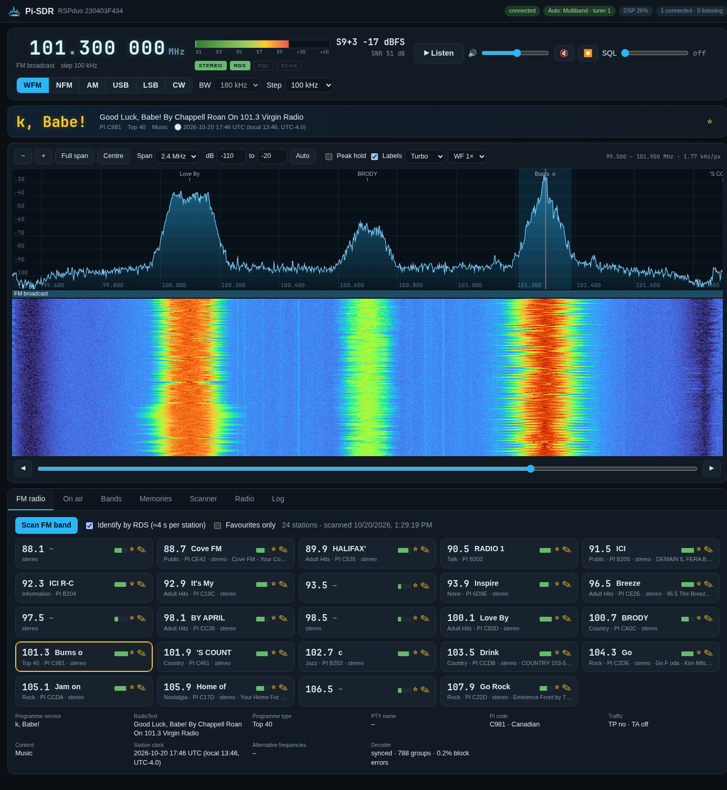

# Pi-SDR

A complete web SDR for an **SDRplay RSPduo** on a headless Raspberry Pi: you open a browser on any other machine,
and the radio, the spectrum and the audio come to you. Covers everything the RSPduo can receive, **1 kHz – 2 GHz**.



## What it does

- **Spectrum + waterfall** of up to 10 MHz at once: click to tune, drag the red line to slide the tuner, drag
  elsewhere to pan, mouse wheel to step (Ctrl/Shift + wheel to zoom), zoom buttons, auto dB range, peak hold, four
  colour maps, waterfall speed. A band-plan strip and labels for FM stations, memories and what's on air.
- **Tuning**: big digit display (scroll over any digit to change it, click to type `101.3`, `7255k`, `1090M`), a
  slider across the visible spectrum, ◀ ▶ step buttons, arrow keys. Tuning inside the captured span is instant;
  outside it the hardware moves.
- **Modes**: WFM (stereo, 75/50 µs de-emphasis), NFM, AM, USB, LSB, CW (adjustable pitch), with per-mode
  bandwidths and squelch remembered.
- **Audio in the browser** (Web Audio, works over plain http on the LAN), volume, mute, and **recording to WAV**.
- **S-meter** with SNR, squelch relative to the noise (so 10 dB means the same on every band and gain).
- **FM radio**: one-button scan of 87.5 – 108 MHz (0.6 s sweep, snapped to the North American odd-tenth grid), each
  station identified by **RDS** (PS name, RadioText, programme type, PI code, clock, alternative frequencies,
  TP/TA, music/speech, stereo), **favourites** ☆ and your own names, kept across rescans.
- **On air**: a station identifier like shortwave.live. On every tune it tells you what's there, using the
  [EiBi](http://www.eibispace.de/dx/) shortwave schedule (downloaded for the current season, refreshed weekly),
  [OurAirports](https://ourairports.com/data/) frequencies for airports within 250 km, and built-in marine VHF,
  Weatheradio, time-signal and utility tables. The On air tab lists every broadcast on air right now by band,
  language or station, tap to tune; on-air stations are labelled on the spectrum.
- **Search**: sweep any range (the whole 1 kHz – 2 GHz takes about a minute), list the active channels on a grid with
  their level above the noise, listen, save selected or all to memories.
- **Scanner**: step through a range, a memory group or the last search; stops on activity, listens until the signal
  has been gone for the hang time, moves on; skip, lock out (remembered), save; every stop logged.
- **Memories** in groups, recall, edit, lock out, export / import (JSON).
- **Bands**: presets for broadcast LW/MW/SW/FM, time & weather (CHU, WWV, Weatheradio, CFH fax), aviation, marine,
  every amateur band, CB, FRS/GMRS, land mobile, railway, ISM, space.
- **Antennas**: auto switching for this station: below 30 MHz the MLA-30 active loop on **tuner 2 with the bias-T
  on**, above it the multiband antenna on **tuner 1**. Or pick tuner 1, tuner 1 Hi-Z or tuner 2 yourself. Each
  antenna keeps its own LNA setting.
- **Gain**: IF AGC (setpoint), LNA state, IF gain reduction, FM / DAB / MW notches, PPM correction, and automatic LNA
  attenuation when the RSPduo reports overload.
- Any number of browsers at once (they share the one radio). Phone friendly.

## How it's built

```
RSPduo ──USB── sdrplay_apiService ── engine/sdr-engine (C++) ──pipes── server.js (Node, pm2) ──WebSocket── browsers
```

- **`engine/`**: `sdr-engine`, C++17 against the SDRplay API 3.x and FFTW. Single-tuner mode at 2.4 – 10 MS/s.
  Spectrum by FFT (Blackman-Harris, averaged); the channel is shifted to 0 Hz with an NCO and decimated in two FIR
  stages to ~240 kHz (the whole FM multiplex), then: WFM discriminator, 19 kHz pilot PLL, 38 kHz stereo decoding,
  15 kHz audio filter and resampling to 48 kHz; RDS from the 57 kHz subcarrier resampled to 19 kHz (16 samples per
  bit): Costas loop, biphase symbol timing, differential decoding, block sync with the (26,16) code and offset
  words, group decoding (0A/0B, 2A/2B, 4A, 10A). Narrow modes: resampled to 48 kHz, channel FIR (complex sideband
  filters for SSB/CW), FM / envelope / product detectors with AGC. Wide sweeps for the scanners retune in steps of
  80 % of the span and stitch the spectra. Commands are JSON lines on stdin; output is framed binary on stdout
  (spectrum, audio, JSON). Uses ~20 – 30 % of one Pi 4 core at 2.4 MS/s.
- **`server.js`**: runs and restarts the engine, owns the tuning policy (move the hardware only when needed, keep the
  signal off the DC spike), the auto antenna and LNA, search / scanner / FM identification, memories and
  favourites (JSON files in `data/`), and fans the radio out to browsers.
- **`ident.js`**: the station identifier (EiBi, OurAirports, fixed tables).
- **`web/`**: the browser app (plain JS modules, no build step).

## Install (Raspberry Pi OS / Debian, arm64)

1. **SDRplay API 3.15**: download `SDRplay_RSP_API-Linux-3.15.2.run` from sdrplay.com and run it (accept the
   licence). Its installer runs `more` and prompts; on a headless box with no terminal, extract it with
   `./SDRplay_RSP_API-Linux-3.15.2.run --noexec --target /tmp/sdrplay` and do what `install_lib.sh` does: copy
   `arm64/libsdrplay_api.so.3.15` to `/usr/local/lib` (plus the `.so.3` and `.so` links), `inc/*.h` to
   `/usr/local/include`, `arm64/sdrplay_apiService` to `/opt/sdrplay_api/`, add the udev rule for 1df7:3020 and the
   `sdrplay.service` systemd unit, then `ldconfig` and `systemctl enable --now sdrplay`.
2. `sudo apt install build-essential nodejs npm libfftw3-dev` and `sudo npm install -g pm2`
3. Copy this folder to the Pi (e.g. `~/pi-sdr`), then `make -C engine && npm install`
4. `pm2 start ecosystem.config.js && pm2 save`, and once `pm2 startup` (run the line it prints as root).
5. Open `http://<pi>:8073/`, press **Listen**.

From a desktop with this repo: `./deploy.sh` (copies to `root@192.168.2.94:/home/jim/pi-sdr`, rebuilds, restarts).

Settings by environment: `PORT` (8073), `DATA_DIR` (`./data`), `HOME_LAT` / `HOME_LON` (for nearby airports;
Hubley NS by default), `AIR_RADIUS_KM` (250).

## API

`GET /api/state`, `/api/status` (levels, gain, load), `/api/memories`, `/api/fm`, `/api/search`, `/api/hits`,
`/api/ident?f=<Hz>`, `/api/onair?start=&end=[&all=1]`, `/api/export`; `POST /api/import`. Everything else goes over
the WebSocket at `/ws` (JSON commands: `tune`, `mode`, `set`, `audio`, `search`, `scanStart`, `fmScan`, …).

## Notes

- The SDRplay API is closed source and its headers aren't in this repo: install the API on the Pi as above.
- A Pi 4 with an RSPduo and a USB SSD wants a good power supply: `vcgencmd get_throttled` should be `0x0`.
- 120 MHz (and other multiples of 24 MHz) show the RSPduo's own reference spurs: lock them out in the scanner.

MIT licence (the SDRplay API has its own).
